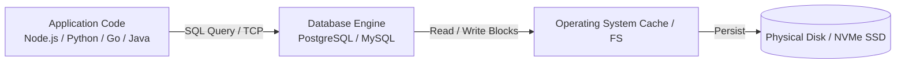

# Part 01: What is a Database?

Welcome to the beginning of your journey into database engineering. In this module, we strip away the jargon to understand what a database really is, why simple text files or spreadsheets fall short for real applications, and how a modern Database Management System (DBMS) functions under the hood.

---

## 1. What is a Database?

At its simplest:

> **A Database is an organized, persistent collection of structured or semi-structured data designed for rapid search, retrieval, updates, and concurrent access.**

A **Database Management System (DBMS)** is the software layer that sits between the physical storage on disk and application code. Examples include PostgreSQL, MySQL, SQLite, Oracle, and MongoDB.



---

## 2. Why Not Just Use Files (CSV, JSON, Spreadsheets)?

When beginners build their first app, they often wonder: *"Why install a heavy database when I can just write JSON files to disk using `fs.writeFileSync` or Python `json.dump`?"*

Here are the **5 Fatal Flaws** of flat-file storage:

| Problem | File-Based Storage (JSON/CSV) | Database Management System (DBMS) |
| :--- | :--- | :--- |
| **1. Concurrency (Race Conditions)** | Two users saving at the same second overwrite each other's changes (lost updates). | Uses granular row-level and page locks, transactions, and MVCC to handle thousands of simultaneous readers and writers. |
| **2. Performance & Scalability** | To find one user in a 10 GB file, you must load and parse all 10 GB into RAM. O(N) linear scan. | Uses indexes (B-Trees) to locate a record in microseconds (O(log N)) without reading the entire dataset. |
| **3. Crash Safety & Atomicity** | If power cuts out mid-write, your JSON file gets corrupted or truncated. | Uses Write-Ahead Logs (WAL) and ACID transactions; uncommitted writes are rolled back, committed writes are guaranteed permanent. |
| **4. Integrity & Constraints** | Code bugs can write negative prices, letters in phone number fields, or duplicate email addresses. | The database enforces constraints (`UNIQUE`, `NOT NULL`, `CHECK (price > 0)`, Foreign Keys) at the storage level. |
| **5. Security & Access Control** | File permissions are all-or-nothing (can read file or cannot). | Fine-grained Role-Based Access Control (RBAC): User A can read `orders`, but only Admin can see `credit_cards`. |

---

## 3. How a DBMS Works Internally

When you send a query like `SELECT * FROM users WHERE age > 21;` to a relational DBMS, it passes through five core architectural subsystems:

```
+-----------------------------------------------------------+
|                      Client Application                   |
+-----------------------------------------------------------+
                             |
                             v  (Connection via TCP port 5432)
+-----------------------------------------------------------+
| 1. Query Parser & Lexer                                   |
|    - Validates SQL syntax                                 |
|    - Builds an Abstract Syntax Tree (AST)                 |
+-----------------------------------------------------------+
                             |
                             v
+-----------------------------------------------------------+
| 2. Query Planner & Optimizer (The Brain)                  |
|    - Evaluates possible execution paths                   |
|    - Uses table statistics to pick the cheapest plan       |
|    - Chooses: Index Scan vs. Sequential Scan              |
+-----------------------------------------------------------+
                             |
                             v
+-----------------------------------------------------------+
| 3. Execution Engine                                       |
|    - Executes the chosen plan nodes (Filter, Join, Sort)  |
+-----------------------------------------------------------+
                             |
                             v
+-----------------------------------------------------------+
| 4. Buffer / Memory Pool (Shared Buffers)                  |
|    - Checks if data pages are already cached in RAM       |
|    - Writes changes to Write-Ahead Log (WAL) first        |
+-----------------------------------------------------------+
                             |
                             v
+-----------------------------------------------------------+
| 5. Storage Engine (Disk I/O)                              |
|    - Reads / Writes 8KB pages to permanent disk storage   |
+-----------------------------------------------------------+
```

---

## 4. The Client-Server Model

Most enterprise databases operate in a client-server architecture:
- **Database Server:** A dedicated process running on a server listening on a network port (e.g., PostgreSQL on port `5432`, MySQL on port `3306`).
- **Database Client:** A command-line tool (`psql`), graphical UI (DBeaver, pgAdmin), or an application driver (Node.js `pg`, Python `psycopg2`, Go `database/sql`).

*(Note: SQLite is an exception—it is an **embedded database** running directly in-process with the application without a separate network server).*

---

## 5. Hands-on Lab: Inspecting the Engine

Let's dive into the SQL code for this module: [`01_system_catalog.sql`](./01_system_catalog.sql).

In this script, you will:
1. Check the database engine version and uptime.
2. Query the **system catalog** (`information_schema` and `pg_catalog`) to see that database metadata is itself stored in relational tables.
3. Create your first table with strict constraints to witness the difference between raw files and a DBMS.
