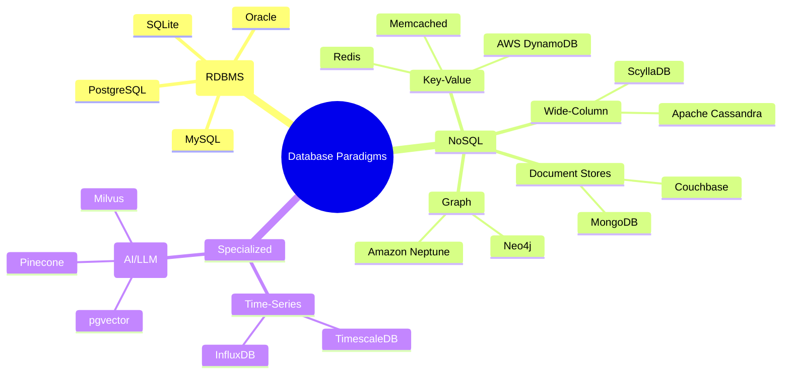

# Part 02: Database Types & Paradigms

No single database is best for every problem. Modern software architectures leverage **Polyglot Persistence**—choosing the right database engine based on data shape, read/write patterns, scalability requirements, and consistency guarantees.

In this module, we dissect all major database categories, explore their trade-offs, and examine the foundational theorems governing distributed databases.

---

## 1. Overview of Database Paradigms



---

## 2. In-Depth Comparison of Database Paradigms

### A. Relational Databases (RDBMS)
* **Core Concept:** Data is structured into mathematical relations (tables) with predefined columns and rows (tuples). Relationships are formed using foreign keys.
* **Query Language:** SQL (Structured Query Language).
* **Guarantees:** Strict ACID transactions, strong consistency, schema enforcement.
* **Best For:** Financial systems, e-commerce checkouts, SaaS platforms, ERP, CRM, and complex relational reporting.
* **Examples:** PostgreSQL, MySQL, SQLite, Microsoft SQL Server.

### B. Document Databases
* **Core Concept:** Stores records as self-contained semi-structured documents (usually JSON or BSON). Each document can have a different structure (polymorphic schema).
* **Key Strengths:** Natural mapping to object-oriented programming (no object-relational impedance mismatch), fast retrieval of complete entities.
* **Best For:** Content management systems (CMS), user profiles, e-commerce product catalogs with varying attributes.
* **Examples:** MongoDB, CouchDB, Amazon DocumentDB.

### C. Key-Value Stores
* **Core Concept:** Simplest data model: a unique string key mapped to an arbitrary binary payload or data structure (string, list, hash, set).
* **Key Strengths:** $O(1)$ constant time lookup, ultra-low sub-millisecond latency, typically held in RAM.
* **Best For:** Session caching, token stores, rate limiters, pub/sub messaging, real-time leaderboards.
* **Examples:** Redis, Memcached, AWS DynamoDB.

### D. Wide-Column (Columnar / Column-Family)
* **Core Concept:** Stores data in column families where rows can have millions of dynamic columns. Optimized for high-throughput writes distributed across clusters.
* **Key Strengths:** Massive linear horizontal scalability, no single point of failure.
* **Best For:** Activity logs, IoT sensor ingestion, telemetry data, analytics over specific columns.
* **Examples:** Apache Cassandra, ScyllaDB, Google Bigtable.

### E. Graph Databases
* **Core Concept:** Focuses on relationships. Represents data as **Nodes** (entities), **Edges** (relationships), and **Properties** (key-value pairs on nodes/edges).
* **Key Strengths:** Relationship traversal in $O(1)$ constant time independent of the overall database size (index-free adjacency). No expensive multi-table joins.
* **Best For:** Social networks, fraud detection, recommendation engines, knowledge graphs, access control trees.
* **Examples:** Neo4j, Amazon Neptune, Memgraph.

### F. Specialized Engines: Time-Series & Vector Databases
* **Time-Series (TimescaleDB, InfluxDB):** Optimized for append-heavy timestamped data, downsampling, and time-bucket aggregations.
* **Vector Databases (pgvector, Pinecone, Milvus):** Stores high-dimensional mathematical vector embeddings generated by machine learning models to perform rapid semantic vector similarity searches (e.g., Cosine Distance, Euclidean Distance).

---

## 3. Distributed Database Theorems: CAP & PACELC

When a database scales across multiple networked servers, it is bound by fundamental physical laws of computer science.

### The CAP Theorem (Eric Brewer)
In any distributed asynchronous network, you can guarantee at most **two out of three**:

```
                 Consistency (C)
                 /             \
                /   RDBMS       \
               /  (Postgres,     \
              /    Oracle)        \
             /                     \
Availability (A) ----------------- Partition Tolerance (P)
  (Cassandra, DynamoDB - AP)        (HBase, MongoDB - CP)
```

1. **Consistency (C):** Every read receives the most recent write or an error.
2. **Availability (A):** Every non-failing node returns a response (without guarantee that it contains the most recent write).
3. **Partition Tolerance (P):** The system continues operating despite network drops or packet delays between nodes.

> **Production Reality:** Network partitions ($P$) are inevitable in physical networks (cables cut, routers fail, latency spikes). Therefore, distributed systems must trade off **Consistency (CP)** vs **Availability (AP)** during a network partition.

### The PACELC Theorem (Daniel Abadi)
CAP only describes what happens **if** there is a Partition ($P$):
- **If Partition ($P$):** Trade-off between Availability ($A$) and Consistency ($C$).
- **Else ($E$):** Trade-off between Latency ($L$) and Consistency ($C$).

---

## 4. ACID vs. BASE

| Feature | ACID (Traditional RDBMS) | BASE (Many NoSQL Systems) |
| :--- | :--- | :--- |
| **Philosophy** | Pessimistic, strict guarantees | Optimistic, high throughput |
| **A** | **Atomicity:** All-or-nothing transactions | **Basically Available:** System stays up despite partial node failures |
| **C / S** | **Consistency:** Database never enters an illegal state | **Soft State:** Data state may drift over time without inputs |
| **I / E** | **Isolation:** Concurrent transactions don't interfere | **Eventual Consistency:** Replicas will converge to the same value eventually |
| **D** | **Durability:** Committed data is never lost | Varies (in-memory with disk snapshots) |

---

## 5. Polyglot Persistence: Modern Hybrid Paradigms

Modern relational databases (especially PostgreSQL) have evolved to become multi-model engines:
- They support standard relational tables.
- They support native binary JSON (`JSONB`) with indexing for document workloads.
- They support vector embeddings via extensions (`pgvector`).
- They support key-value semantics via `HSTORE`.

Head over to [`02_relational_vs_json.sql`](./02_relational_vs_json.sql) to compare relational normalized design against semi-structured JSONB documents inside SQL!
