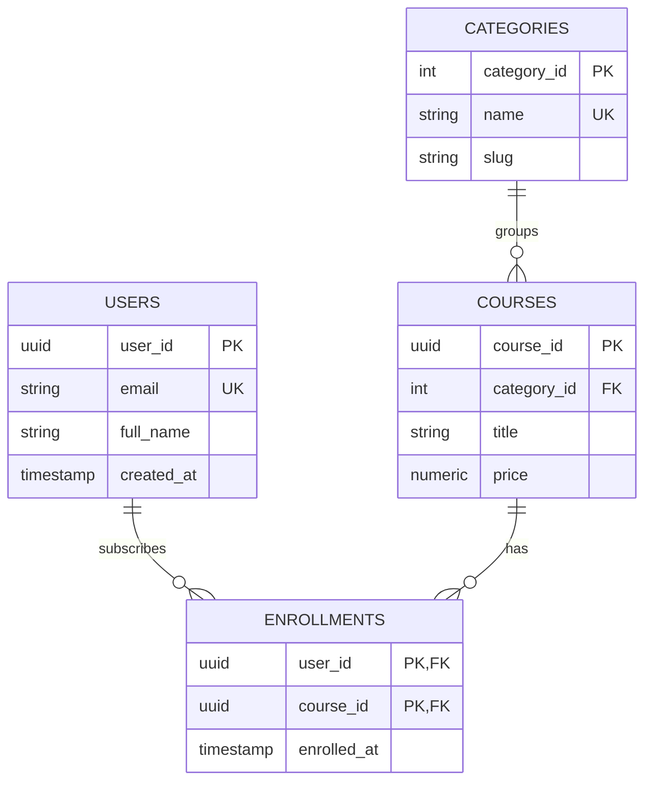

# Part 03: Relational Modeling & DDL (Data Definition Language)

The relational model, introduced by Edgar F. Codd in 1970, remains the most resilient and mathematically sound way to model business entities.

In this module, you will master **DDL (Data Definition Language)**—the SQL subset used to define, alter, and manage database schemas, tables, relationships, and constraints.

---

## 1. Core Terminology: Codd's Relational Theory vs. SQL

| Relational Theory | SQL Implementation | Everyday Analogy |
| :--- | :--- | :--- |
| **Relation** | **Table** | A 2D spreadsheet / dataset of a single entity |
| **Tuple** | **Row** / Record | A single instance of that entity (e.g., user Alice) |
| **Attribute** | **Column** / Field | A specific property of that entity (e.g., email) |
| **Domain** | **Data Type & Constraints** | The set of allowable values (e.g., valid integer > 0) |

---

## 2. SQL Data Types Deep Dive

Choosing the correct data type directly affects memory consumption, disk I/O, cache efficiency, and numeric precision.

### Numbers: Floating Point vs. Exact Numerics
> **CRITICAL RULE:** **NEVER** use `FLOAT`, `REAL`, or `DOUBLE PRECISION` for currency, accounting, or money!

- **`FLOAT` / `DOUBLE`:** IEEE 754 binary floating-point. Fast, but incurs rounding errors ($0.1 + 0.2 \neq 0.3$).
- **`NUMERIC(precision, scale)` or `DECIMAL`:** Exact fixed-point numeric storage. Essential for financial amounts (e.g., `NUMERIC(10, 2)` allows up to 8 digits before the decimal and 2 after).
- **`INTEGER` (4 bytes):** Range $-2.1\text{B}$ to $+2.1\text{B}$.
- **`BIGINT` (8 bytes):** Range $-9.22 \times 10^{18}$ to $+9.22 \times 10^{18}$. Essential for large primary keys and high-volume IDs.

### Strings: CHAR vs. VARCHAR vs. TEXT
- **`CHAR(n)`:** Fixed length, space-padded. Rarely needed today except for strict codes (e.g., 2-letter ISO country codes `US`, `FR`).
- **`VARCHAR(n)`:** Variable length with maximum length $n$.
- **`TEXT`:** Variable length with no arbitrary limit. In modern engines like PostgreSQL, `VARCHAR` and `TEXT` have identical underlying storage performance.

### Date & Time: Always Use Timezones
- **`TIMESTAMP WITHOUT TIME ZONE`:** Stores a wall-clock time without timezone offset. (Dangerous across timezones!)
- **`TIMESTAMPTZ` (`TIMESTAMP WITH TIME ZONE`):** Standardizes time to UTC internally. When queried, displays converted to the client's session timezone. **Always use this for event logs and audit timestamps.**

---

## 3. Keys and Identity



### Primary Key (PK)
A column (or set of columns) that uniquely identifies each row. Must be `NOT NULL` and `UNIQUE`.
- **Natural Key:** An existing business property that is uniquely identifying (e.g., International Standard Book Number - ISBN, VIN). Fragile if business rules change.
- **Surrogate Key:** A system-generated arbitrary unique identifier with no intrinsic business meaning.
  - **Serial / Bigserial (Auto-increment integer):** Compact (4 or 8 bytes), excellent B-Tree locality. Risk: sequential IDs can be enumerated by attackers.
  - **UUIDv4 / UUIDv7:** Globally unique (128-bit), safe against enumeration, ideal for distributed microservices.

### Foreign Key (FK) & Referential Actions
A foreign key points to the primary key of another table, ensuring that relationships cannot point to non-existent data ("orphaned records").

When the referenced parent row is updated or deleted, what happens to the children?
1. **`ON DELETE RESTRICT` (or `NO ACTION`):** Prevents deletion of the parent if children exist (Default safe behavior).
2. **`ON DELETE CASCADE`:** Automatically deletes all child rows when the parent row is deleted.
3. **`ON DELETE SET NULL`:** Keeps child rows, setting their foreign key column to `NULL`.

---

## 4. DDL Statements in Practice

```sql
-- Creating a table
CREATE TABLE courses (
    course_id   UUID PRIMARY KEY DEFAULT gen_random_uuid(),
    title       VARCHAR(200) NOT NULL,
    price       NUMERIC(8, 2) NOT NULL CHECK (price >= 0),
    is_published BOOLEAN NOT NULL DEFAULT FALSE,
    created_at  TIMESTAMPTZ NOT NULL DEFAULT CURRENT_TIMESTAMP
);

-- Modifying schema
ALTER TABLE courses ADD COLUMN difficulty_level VARCHAR(20) DEFAULT 'Beginner';
ALTER TABLE courses DROP COLUMN difficulty_level;
```

Explore [`03_schema_definition.sql`](./03_schema_definition.sql) to see the complete production-grade schema setup.
