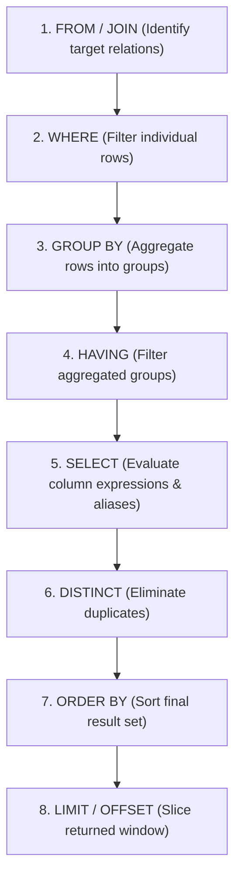

# Part 05: Querying & Filtering Essentials (DQL Core)

Every developer writes `SELECT` statements, but very few understand the internal execution order of SQL or how the engine handles **Three-Valued Logic (3VL)**.

In this module, you will master the foundational mechanics of **Data Query Language (DQL)**.

---

## 1. The Real Execution Order of a SQL Query

When writing SQL, you write:
```sql
SELECT title, price         -- Step 5
FROM courses                -- Step 1
WHERE is_published = TRUE   -- Step 2
ORDER BY price DESC         -- Step 6
LIMIT 5;                    -- Step 7
```

Notice the paradox: **You write `SELECT` first, but the database engine executes it near the end!**



> **Key Takeaway:** You cannot use a column alias declared in `SELECT` inside your `WHERE` clause because the `WHERE` filter runs *before* the `SELECT` projection exists!

---

## 2. Three-Valued Logic (3VL) & The `NULL` Mystery

In classical Boolean logic, an expression is either `TRUE` or `FALSE`. In SQL, there is a third state: **`UNKNOWN`**.

`NULL` represents missing, unknown, or inapplicable data. Because of this:
```sql
NULL = NULL     -- Evaluates to UNKNOWN (NOT TRUE!)
NULL != 5       -- Evaluates to UNKNOWN
NULL = 5        -- Evaluates to UNKNOWN
```

### The Common Bug:
If you have a column `discount_code` where some rows are `'SUMMER'` and some are `NULL`:
```sql
-- DANGER: This will NOT return rows where discount_code IS NULL!
SELECT * FROM orders WHERE discount_code != 'SUMMER';
```
Because `NULL != 'SUMMER'` evaluates to `UNKNOWN`, and a `WHERE` clause only keeps rows that evaluate strictly to `TRUE`!

### The Solution:
Use `IS NULL`, `IS NOT NULL`, or `COALESCE`:
```sql
SELECT * FROM orders
WHERE discount_code != 'SUMMER' OR discount_code IS NULL;

-- Or using COALESCE:
SELECT * FROM orders
WHERE COALESCE(discount_code, '') != 'SUMMER';
```

---

## 3. String & Pattern Matching

- **`LIKE 'Postgre%'`:** Starts with "Postgre" (case-sensitive).
- **`ILIKE '%sql%'`:** Contains "sql" anywhere (case-insensitive in PostgreSQL).
- **`LIKE '_at'`:** Matches "cat", "bat", "rat" (single character wildcard `_`).

---

## 4. Pagination: Offset vs. Keyset (Cursor) Pagination

When building REST APIs or user interfaces with pagination:

### A. The Offset Method (Beginner)
```sql
SELECT * FROM courses
ORDER BY created_at DESC
LIMIT 20 OFFSET 100000;
```
**Why this breaks in production:** To return 20 rows at offset 100,000, the database engine must scan, sort, and count 100,020 rows, then discard the first 100,000. Performance degrades linearly ($O(N)$) as the page number increases.

### B. Keyset / Cursor Pagination (Senior / Production)
Instead of counting rows to discard, jump directly to the target record using indexed ordering:
```sql
SELECT * FROM courses
WHERE created_at < '2026-10-01 12:00:00+00' -- Value of last item on previous page
ORDER BY created_at DESC
LIMIT 20;
```
Performance remains $O(1)$ constant time regardless of whether you are on page 1 or page 50,000!

---

Check out [`05_filtering_and_sorting.sql`](./05_filtering_and_sorting.sql) for practical queries demonstrating all filtering rules, null quirks, and cursor pagination.
