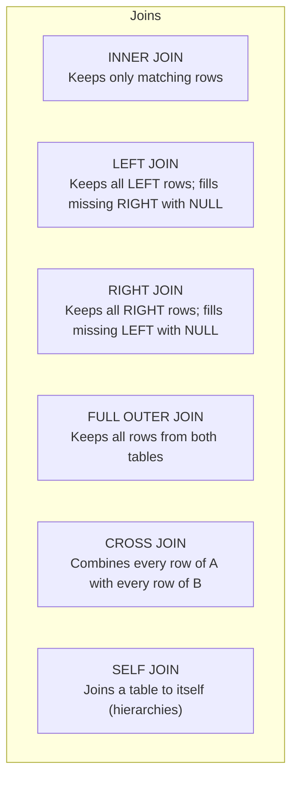

# Part 07: Table Joins & Relationships

In a properly normalized database, data is decomposed across multiple tables to avoid duplication. **Joins** are the relational algebra operations that assemble these disparate tables back into a coherent whole at query time.

In this module, you will master all join types, self-referential hierarchies, semi-joins, and anti-joins.

---

## 1. Visualizing Join Types with Venn Diagrams & Sets

```
   Table A (Left)                Table B (Right)
     +---------+                 +---------+
     |  A   AB |                 |   AB  B |
     +---------+                 +---------+

  INNER JOIN:                   Only the intersection (AB)
  LEFT JOIN:                    All of A + matching parts of B (A + AB)
  RIGHT JOIN:                   All of B + matching parts of A (B + AB)
  FULL OUTER JOIN:              Everything from both tables (A + AB + B)
  CROSS JOIN:                   Cartesian product (A x B total combinations)
```



---

## 2. Join Syntax and Mechanics

### A. `INNER JOIN`
Returns only rows where the join predicate evaluates to `TRUE`. If a record in Table A has no matching key in Table B, it is omitted.
```sql
SELECT u.username, c.title
FROM users u
INNER JOIN enrollments e ON u.user_id = e.user_id
INNER JOIN courses c     ON e.course_id = c.course_id;
```

### B. `LEFT (OUTER) JOIN`
Preserves every single row from the left table. If there is no corresponding row in the right table, columns from the right table are populated with `NULL`.
```sql
-- List ALL users, including those who have never enrolled in any course:
SELECT u.username, e.course_id, e.enrolled_at
FROM users u
LEFT JOIN enrollments e ON u.user_id = e.user_id;
```

### C. `FULL OUTER JOIN`
Combines results of both Left and Right outer joins. Unmatched rows from either side contain `NULL` for the other table.

---

## 3. The `SELF JOIN`: Hierarchies & Org Charts

When an entity has a relationship with entities of the same type (e.g., an Employee has a Manager who is also an Employee), we join the table to itself using two distinct aliases:

```sql
SELECT
    emp.full_name AS employee_name,
    mgr.full_name AS manager_name
FROM employees emp
LEFT JOIN employees mgr ON emp.manager_id = mgr.employee_id;
```

---

## 4. Semi-Joins and Anti-Joins

These are two of the most critical query patterns in production database engineering:

### A. Semi-Join ("Does a matching record exist?")
Selects rows from Table A where at least one matching row exists in Table B, without duplicating rows if Table B has multiple matches:
```sql
SELECT * FROM users u
WHERE EXISTS (
    SELECT 1 FROM enrollments e WHERE e.user_id = u.user_id
);
```

### B. Anti-Join ("Find rows with NO match")
Finds records in Table A that have zero occurrences in Table B.

**Approach 1: Left Join with `IS NULL` check**
```sql
SELECT u.username, u.email
FROM users u
LEFT JOIN enrollments e ON u.user_id = e.user_id
WHERE e.user_id IS NULL;
```

**Approach 2: `NOT EXISTS` (Recommended for performance and clarity)**
```sql
SELECT u.username, u.email
FROM users u
WHERE NOT EXISTS (
    SELECT 1 FROM enrollments e WHERE e.user_id = u.user_id
);
```

> [!NOTE]
> `NOT IN (SELECT foreign_id FROM ...)` is dangerous if the subquery returns even a single `NULL`, as `NOT IN (..., NULL)` will cause the entire query to return 0 rows! `NOT EXISTS` is always NULL-safe.

---

Check out [`07_joins_mastery.sql`](./07_joins_mastery.sql) to run every join type with step-by-step explanatory comments.
