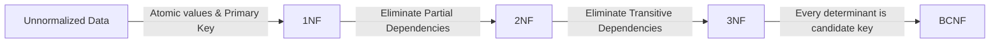
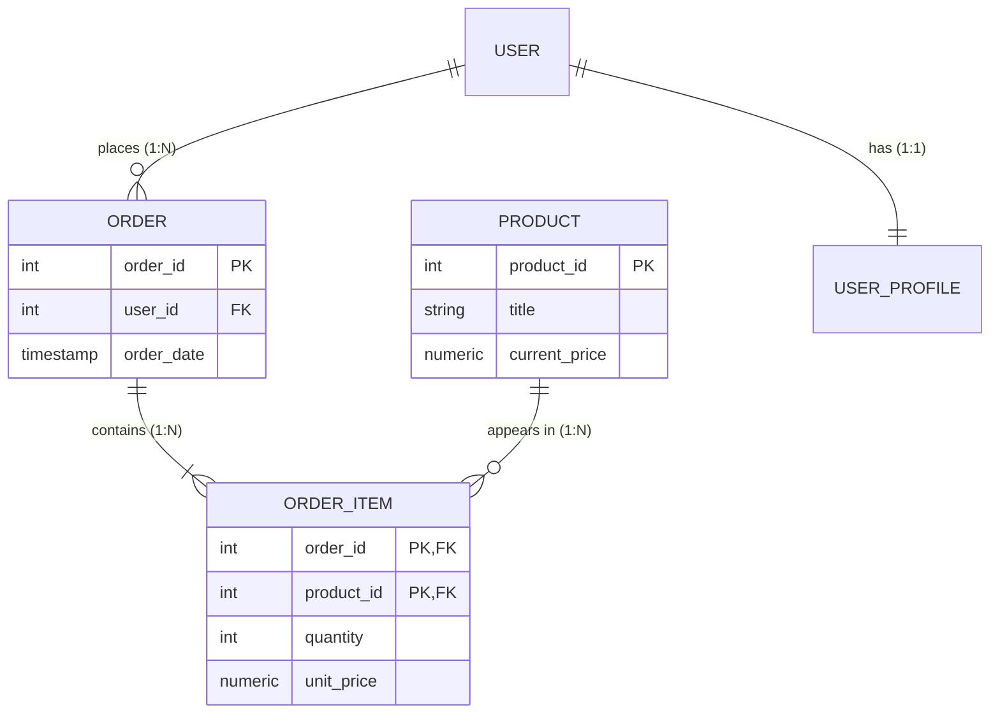

# Part 10: Database Normalization & Schema Design

Poor schema design is the #1 cause of data corruption, race conditions, and query slowdowns. **Normalization** is the mathematical process of structuring a relational database to minimize data redundancy and prevent modification anomalies.

In this module, you will learn how to transition schemas from unnormalized spreadsheets up to **3NF / BCNF**, and when to intentionally denormalize for performance.

---

## 1. The Three Modification Anomalies

Imagine a single unnormalized spreadsheet table:
`orders(order_id, customer_name, customer_city, product_name, product_price)`

```
+----------+---------------+---------------+--------------------+---------------+
| order_id | customer_name | customer_city | product_name       | product_price |
+----------+---------------+---------------+--------------------+---------------+
| 1001     | Alice         | New York      | Mechanical Keyboard| $90.00        |
| 1002     | Alice         | New York      | Wireless Mouse     | $50.00        |
| 1003     | Bob           | London        | Mechanical Keyboard| $90.00        |
+----------+---------------+---------------+--------------------+---------------+
```

1. **Update Anomaly:** If the price of "Mechanical Keyboard" increases to \$95.00, we must find and update every single order row in the table. If one row is missed, data becomes inconsistent.
2. **Insertion Anomaly:** We cannot add a new product into our inventory unless a customer actually places an order for it!
3. **Deletion Anomaly:** If Bob cancels order #1003 and we delete the row, we lose our only record that Bob lives in London!

---

## 2. The Normal Forms Step-by-Step



### First Normal Form (1NF)
- **Requirement 1:** Every column must hold atomic (indivisible) values. (No comma-separated values like `"Red, Blue, Green"`).
- **Requirement 2:** No repeating groups or column arrays (`phone_1`, `phone_2`, `phone_3`).
- **Requirement 3:** Each row must have a unique identifier (Primary Key).

### Second Normal Form (2NF)
- **Requirement 1:** Must be in 1NF.
- **Requirement 2:** No **Partial Key Dependencies**. Every non-key attribute must depend on the **entire** primary key (relevant when a table has a composite primary key like `(order_id, product_id)`).

### Third Normal Form (3NF)
> *"Every non-key attribute must provide a fact about the key, the whole key, and nothing but the key, so help me Codd."*

- **Requirement 1:** Must be in 2NF.
- **Requirement 2:** No **Transitive Dependencies**. A non-key column must not depend on another non-key column ($A \rightarrow B \rightarrow C$).
- *Example:* In `orders(order_id, customer_id, customer_zip, customer_city)`, `customer_city` depends on `customer_zip`, which depends on `customer_id`. Extract `(zip, city)` into an independent lookup table!

---

## 3. Entity-Relationship (ER) Cardinalities



- **1 to 1 (1:1):** Split for security or sparse data (e.g., `users` and `user_passports`).
- **1 to Many (1:N):** Foreign key lives in the "Many" table (e.g., `customer_id` lives inside `orders`).
- **Many to Many (N:M):** Requires a **Junction / Bridge table** (e.g., `order_items` bridges `orders` and `products`).

---

## 4. When to Denormalize

In high-throughput Online Transaction Processing (OLTP) and analytics (OLAP), strict 3NF can cause join overhead across 15+ tables.

**Engineers selectively denormalize when:**
1. **Historical Immutability:** Storing `historical_unit_price` in `order_items` at the time of purchase. Even if the product price changes tomorrow, old receipts must remain historically accurate.
2. **Heavy Read-to-Write Ratio:** Caching `total_spent` or `comment_count` directly on parent rows to avoid continuous expensive `COUNT(*)` queries.
3. **Data Warehouses & Star Schemas:** Fact and Dimension tables optimized for analytical scanning (Snowflake, BigQuery).

Examine [`10_normalization_case_study.sql`](./10_normalization_case_study.sql) to see an unnormalized legacy spreadsheet transformed into a clean 3NF relational model.
