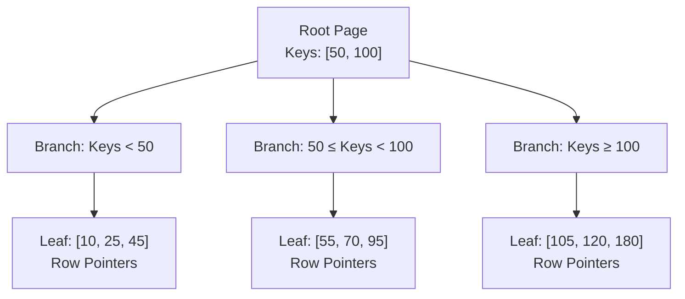

# Part 11: Indexing & Query Performance Optimization

Indexes are the single most critical tool for transforming multi-second sluggish queries into sub-millisecond responses.

In this module, we explore the physical disk storage mechanics of a DBMS, how **B-Trees** work under the hood, how to interpret **`EXPLAIN ANALYZE`** execution plans, and how to design covering and partial indexes.

---

## 1. Physical Storage: Pages, Blocks & Heaps

Databases do not read data byte-by-byte from SSDs. They read and write fixed-size memory chunks called **Pages** (or Blocks), typically **8 KB** in PostgreSQL.

```
Disk Page (8 KB)
+-----------------------------------------------------------+
| Page Header (LSN, free space pointers, flags)             |
| Item Id Pointers (offsets to tuples)                      |
|                     <-- Free Space -->                    |
| Tuple 3 (Row Data)                                        |
| Tuple 2 (Row Data)                                        |
| Tuple 1 (Row Data)                                        |
+-----------------------------------------------------------+
```

When you run `SELECT * FROM users WHERE email = 'dan@example.com';` **without an index**:
The engine must perform a **Sequential Scan (Seq Scan)**—it loads *every single 8 KB page* from disk into RAM, parsing every tuple one by one ($O(N)$ linear time). On a 50-million-row table, this can take minutes and saturate disk I/O.

---

## 2. The B-Tree Index (The Workhorse)

A **B-Tree (Balanced Tree)** is a self-balancing search tree organized into:
1. **Root Page**
2. **Internal Pages (Branch routing pointers)**
3. **Leaf Pages (Contains sorted indexed keys and pointers to heap physical row IDs - `TID`)**



Because leaf pages are linked sequentially in a doubly linked list, B-Trees excel at:
- Equality searches: `WHERE id = 50` ($O(\log N)$)
- Range searches: `WHERE age BETWEEN 20 AND 30`
- Sorted ordering: `ORDER BY created_at`

---

## 3. Index Types Compared

| Index Type | Algorithmic Structure | Best Use Case |
| :--- | :--- | :--- |
| **B-Tree** | Balanced Tree | Default choice: equality, ranges (`<`, `>`, `BETWEEN`), sorting (`ORDER BY`). |
| **Hash** | Hash Table | Ultra-fast exact equality (`=`) only. No range searches. |
| **GIN** | Generalized Inverted Index | JSONB documents, arrays, full-text search tokens. |
| **GiST** | Generalized Search Tree | Geometric/GIS coordinates (PostGIS), IP address ranges. |
| **BRIN** | Block Range Index | Massive append-only logs (billions of rows sorted by timestamp). Tiny memory footprint. |

---

## 4. Multi-Column Indexes & The Leftmost Prefix Rule

When you create a composite index:
```sql
CREATE INDEX idx_users_country_city ON users (country, city);
```
The tree is sorted primarily by `country`, and only secondarily by `city` within each country.

- `WHERE country = 'France' AND city = 'Paris'` $\rightarrow$ **Uses Index ✅**
- `WHERE country = 'France'` $\rightarrow$ **Uses Index ✅**
- `WHERE city = 'Paris'` $\rightarrow$ **CANNOT use index! ❌** (Because Paris entries are scattered across every country branch).

---

## 5. Reading `EXPLAIN` and `EXPLAIN ANALYZE`

- `EXPLAIN` outputs the Query Optimizer's **estimated cost**.
- `EXPLAIN ANALYZE` **actually executes** the query and returns real execution time in milliseconds along with exact row counts.

### Scan Types in Order of Speed:
1. **Index Only Scan (Fastest):** All requested columns are found inside the index leaf page itself. Zero heap disk pages are touched (Covering Index).
2. **Index Scan:** Finds matching row IDs in the index, then fetches remaining columns from the heap table.
3. **Bitmap Index Scan:** Collects matching row pointers into an in-memory bitmap, sorts them physically, and reads heap pages sequentially.
4. **Seq Scan (Slowest on large tables):** Scans the entire raw table from start to finish.

---

## 6. Pro-Tip: Partial & Expression Indexes

### A. Partial Indexes (Save 90% Storage)
If 98% of your orders are `completed` and you only query `pending` orders:
```sql
-- Indexes only the 2% of unfulfilled orders!
CREATE INDEX idx_orders_pending ON orders (created_at)
WHERE status = 'pending';
```

### B. Expression Indexes
```sql
-- Fixes case-insensitive email searches:
CREATE INDEX idx_users_lower_email ON users (lower(email));
```

Head to [`11_indexing_and_explain.sql`](./11_indexing_and_explain.sql) to generate 100,000 synthetic rows and benchmark execution plans firsthand.
