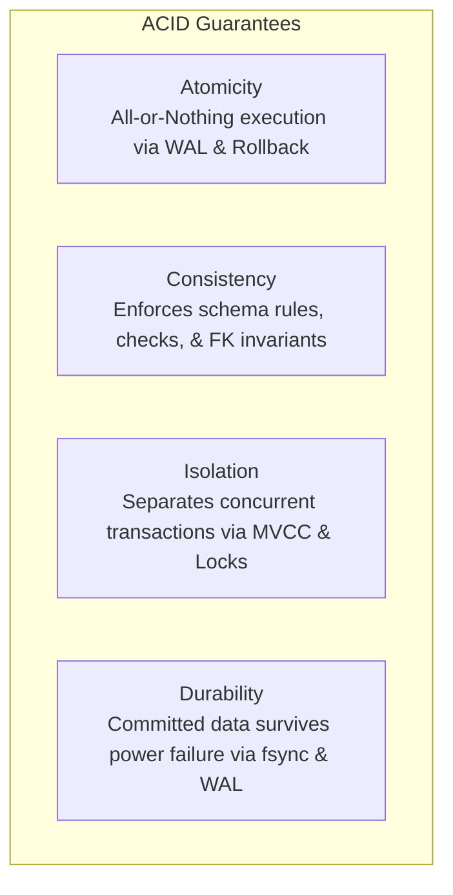

# Part 12: Transactions, ACID & Concurrency Control

When thousands of users interact with a database simultaneously (booking seats, transferring bank balances, checking out inventory), race conditions will corrupt your data unless you understand **ACID** and **Concurrency Control**.

In this module, you will master transactions, isolation levels, row locks, deadlocks, and **MVCC (Multi-Version Concurrency Control)**.

---

## 1. Deconstructing ACID



### Write-Ahead Logging (WAL) & Durability
How can a database be fast *and* crash-proof?
If a DBMS wrote every modified 8 KB table page to disk immediately during a transaction, disk heads would thrash with random I/O.

Instead, the database uses **Write-Ahead Logging (WAL)**:
1. Every modification is appended sequentially to an append-only log file on disk (WAL) and `fsync`ed.
2. The data pages in RAM (Shared Buffers) are updated in memory ("dirty pages").
3. The transaction is marked committed.
4. If power cuts out 1 millisecond later, the database restarts, replays the WAL log, and restores all committed data without losing a single byte!

---

## 2. Concurrency Anomalies & SQL Isolation Levels

When two transactions run at the exact same millisecond, what can go wrong?

| Isolation Level | Dirty Read | Non-Repeatable Read | Phantom Read | Serialization Anomaly |
| :--- | :---: | :---: | :---: | :---: |
| **Read Uncommitted** | ❌ Allowed | ❌ Allowed | ❌ Allowed | ❌ Allowed |
| **Read Committed** *(Postgres default)* | ✅ Prevented | ❌ Allowed | ❌ Allowed | ❌ Allowed |
| **Repeatable Read** | ✅ Prevented | ✅ Prevented | ✅ Prevented* | ❌ Allowed (Write Skew) |
| **Serializable** | ✅ Prevented | ✅ Prevented | ✅ Prevented | ✅ Prevented |

*\*Note: In PostgreSQL, Repeatable Read also prevents Phantom Reads through snapshot isolation.*

---

## 3. Pessimistic vs. Optimistic Concurrency Control

### A. The Double-Spending Race Condition
Two requests come in at the same time to deduct \$100 from an account with \$100 balance:
1. Session A reads balance: \$100 (sufficient).
2. Session B reads balance: \$100 (sufficient).
3. Session A writes balance: \$100 - \$100 = \$0.
4. Session B writes balance: \$100 - \$100 = \$0.
5. The customer withdrew \$200 from a \$100 account!

### B. Pessimistic Locking (`SELECT ... FOR UPDATE`)
Acquires an exclusive lock on the selected row until the transaction finishes. Any other session attempting to read or update that row is put to sleep until the lock is released:
```sql
BEGIN;
SELECT balance FROM bank_accounts WHERE account_id = 101 FOR UPDATE;
-- Session B must wait here until Session A commits!
UPDATE bank_accounts SET balance = balance - 100 WHERE account_id = 101;
COMMIT;
```

### C. Optimistic Concurrency Control (OCC)
Best for read-heavy apps with low contention. No locks held. Instead, update uses a version number:
```sql
UPDATE products
SET stock = stock - 1, version = version + 1
WHERE product_id = 42 AND version = 5;

-- If rows affected == 0, another user modified the row first! Retry or abort.
```

---

## 4. MVCC: Why Readers Never Block Writers

In legacy databases, when a writer updated a table, all readers were blocked until the write finished.

Modern databases (PostgreSQL, MySQL InnoDB) use **Multi-Version Concurrency Control (MVCC)**:
- When a row is updated, the DBMS **does not overwrite** the old row on disk.
- It inserts a **new version** of the tuple and marks the old tuple with a deletion timestamp (`xmax`).
- Readers inspect a "snapshot" of the database taken at the start of their query and only see rows valid for their transaction ID.
- **Result:** Readers never block writers, and writers never block readers!

Head to [`12_transactions_and_locks.sql`](./12_transactions_and_locks.sql) to run transactions with savepoints, row locks, and inspect MVCC hidden system columns (`xmin`, `xmax`).
