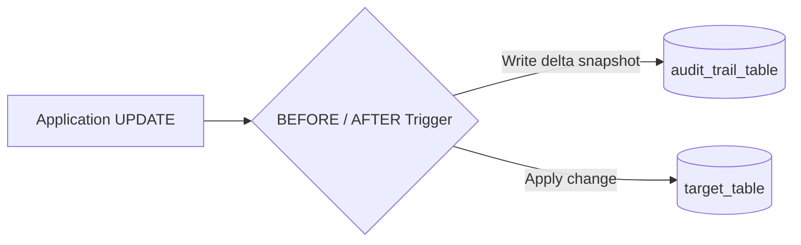

# Part 13: Views, Stored Functions, Triggers & Database Security

A database is not just a passive bucket for data—it is a programmable, active computing engine capable of enforcing security boundaries, maintaining audit trails, and executing transactional logic.

In this module, you will master **Views**, **Materialized Views**, **PL/pgSQL Functions**, **Automated Audit Triggers**, and **Database Security (RLS & SQL Injection prevention)**.

---

## 1. Standard Views vs. Materialized Views

```
+-----------------------------------------------------------+
| Standard View                                             |
| - A saved named query definition.                         |
| - Holds ZERO physical data on disk.                       |
| - When queried, the engine runs the underlying SQL again. |
| - Always 100% up-to-date.                                 |
+-----------------------------------------------------------+

+-----------------------------------------------------------+
| Materialized View                                         |
| - Runs the query and writes the results to a disk table.  |
| - Consumes disk space and can be indexed!                 |
| - Lightning fast reads for expensive analytical queries.   |
| - Must be refreshed periodically (data can be stale).     |
+-----------------------------------------------------------+
```

### Refreshing Materialized Views Without Locking Reads:
```sql
-- Requires a UNIQUE index on the materialized view
REFRESH MATERIALIZED VIEW CONCURRENTLY mv_monthly_revenue_summary;
```

---

## 2. Functions vs. Stored Procedures

| Feature | User-Defined Function (UDF) | Stored Procedure |
| :--- | :--- | :--- |
| **Invocation** | Called inside queries: `SELECT calculate_tax(price)` | Called explicitly: `CALL process_monthly_payroll()` |
| **Return Value** | Must return a value, composite type, or table | May or may not return values via output parameters |
| **Transaction Control** | **Cannot** execute `COMMIT` or `ROLLBACK` | **Can** begin, commit, and rollback transactions |

---

## 3. Automated Audit Trails with Triggers

In regulated industries (healthcare, finance, security), you must be able to answer: *"Who changed customer X's bank balance from \$500 to \$5,000 at 2 AM?"*

Instead of relying on application developers to remember to log changes, we implement a **Database Trigger** that runs automatically on every `UPDATE` or `DELETE`.



Inside trigger functions:
- **`OLD`:** A pseudo-record holding the row's values *before* the modification.
- **`NEW`:** A pseudo-record holding the row's values *after* the modification.

---

## 4. Database Security Essentials

### A. SQL Injection (SQLi)
The most infamous vulnerability in web history:
```python
# VULNERABLE CODE (String Concatenation):
query = f"SELECT * FROM users WHERE username = '{user_input}'"
# If user inputs: admin' --
# The query becomes: SELECT * FROM users WHERE username = 'admin' --'
```

**The Universal Fix:** **Parameterized Queries (Prepared Statements)**
```python
# SAFE (Database driver treats input purely as data, never executable syntax):
cursor.execute("SELECT * FROM users WHERE username = %s", (user_input,))
```

### B. Row-Level Security (RLS)
RLS lets you restrict which rows a user can see directly at the database engine level. Even if the application accidentally runs `SELECT * FROM tenant_documents`, PostgreSQL will only return rows belonging to the authenticated tenant!

```sql
ALTER TABLE documents ENABLE ROW LEVEL SECURITY;

CREATE POLICY tenant_isolation_policy ON documents
FOR ALL
USING (tenant_id = current_setting('app.current_tenant_id')::uuid);
```

Explore [`13_programmable_objects.sql`](./13_programmable_objects.sql) to deploy views, triggers, and Row-Level Security policies.
