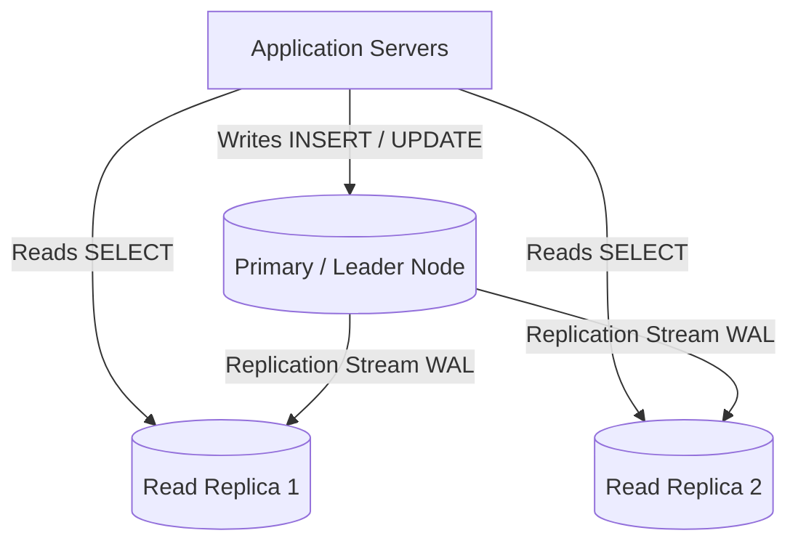
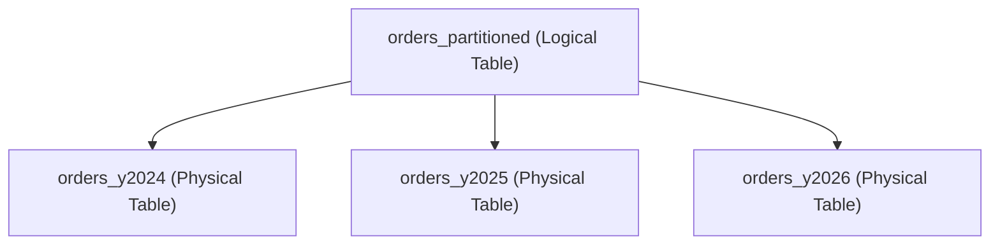

# Part 14: Database Architecture, Scaling & High Availability

When a service grows from 1,000 users to 100 million users, even the most optimal queries and indexes can overwhelm a single database server.

In this capstone module, you will learn the architectural patterns used by Staff and Principal Engineers to scale relational databases horizontally across clusters.

---

## 1. Vertical Scaling vs. Horizontal Scaling

```
Vertical Scaling (Scale-Up)             Horizontal Scaling (Scale-Out)
   +--------------------+               +--------+  +--------+  +--------+
   |  64 CPU Cores      |               | Node 1 |  | Node 2 |  | Node 3 |
   |  512 GB RAM        |               | 8 Cores|  | 8 Cores|  | 8 Cores|
   |  8 TB NVMe RAID    |               +--------+  +--------+  +--------+
   +--------------------+               Distributed Cluster (Shared Nothing)
```

| Dimension | Vertical Scaling (Scale-Up) | Horizontal Scaling (Scale-Out) |
| :--- | :--- | :--- |
| **Complexity** | Zero application changes. Simple. | High. Requires cluster orchestration and routing. |
| **Data Consistency** | Simple ACID transactions on one node. | Complex distributed consensus (Raft, Paxos, 2PC). |
| **Cost Ceiling** | Exponentially expensive for top-tier hardware. | Uses cost-effective commodity cloud instances. |
| **Hard Ceiling** | Limited by maximum motherboard RAM/CPU sockets. | Theoretically limitless throughput. |

---

## 2. Replication: Primary-Replica Topology

90% of web workloads are **Read-Heavy** (e.g., 95 reads for every 5 writes). We scale this using **Read Replicas**:



### Synchronous vs. Asynchronous Replication
- **Asynchronous (Default):** Primary commits immediately, then streams WAL to replicas.
  - *Advantage:* Fast write latency.
  - *Risk:* If Primary crashes before a replica receives the WAL, data loss occurs (**Replication Lag**).
- **Synchronous:** Primary waits until at least one replica confirms disk write before acknowledging commit to the client.
  - *Advantage:* Zero data loss (RPO = 0).
  - *Trade-off:* Slower write latency (bound by network roundtrip time).

---

## 3. Declarative Table Partitioning

When a table reaches hundreds of gigabytes (e.g., billions of audit logs or transactions), single B-Tree indexes become too large to fit in RAM.

**Partitioning** splits one logical table into smaller, independent physical tables under the hood:



### The Magic of Partition Pruning
When you query:
```sql
SELECT * FROM orders_partitioned
WHERE order_date BETWEEN '2026-05-01' AND '2026-05-31';
```
The Query Optimizer performs **Partition Pruning**—it completely ignores `orders_y2024` and `orders_y2025`, opening only the single 2026 partition!

---

## 4. Connection Pooling: Why You Need PgBouncer

In PostgreSQL, each client connection is a dedicated operating system process consuming ~10 MB of RAM. If 5,000 serverless functions spin up simultaneously:
- The OS runs out of file descriptors and memory.
- CPU wastes cycles on process context-switching.

**A Connection Pooler (PgBouncer, HikariCP)** maintains a warm pool of 50-100 open database connections and multiplexes thousands of incoming application requests across them.

---

## 5. Maintenance: `VACUUM` and Dead Tuples

Because MVCC writes new tuple versions instead of overwriting rows in-place, deleted and updated rows leave behind "dead tuples".

- **`VACUUM`:** Scans pages, marks dead tuple space as reusable for future inserts.
- **`VACUUM FULL`:** Rewrites the entire table to a new disk file to reclaim raw OS disk space (requires an exclusive table lock).
- **`ANALYZE`:** Collects column distribution statistics so the query optimizer picks optimal execution plans.

Explore [`14_partitioning_and_maintenance.sql`](./14_partitioning_and_maintenance.sql) to build a range-partitioned table and witness partition pruning in action!
