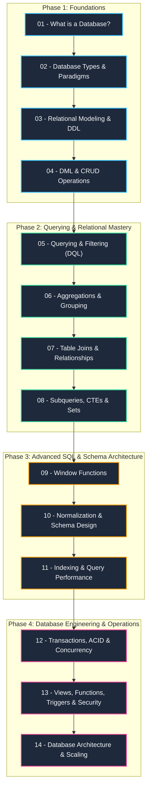

# 🗄️ Full Database & SQL Engineering Course: Zero to Advanced

Welcome to the **Complete Database & SQL Engineering Course**. This repository contains a structured, end-to-end curriculum designed to take you from absolute zero (what is data and why do we need databases?) to advanced architectural concepts (indexing internals, query optimization, ACID transactions, MVCC, and horizontal scaling).

Every module is housed in its own directory with an in-depth **`README.md` guide** and runnable **`.sql` hands-on scripts**.

---

## 🗺️ Course Curriculum Roadmap



---

## 📚 Module Overview

| # | Module Folder | Core Concepts Covered | SQL Script |
|---|---------------|-----------------------|------------|
| **01** | [`01-what-is-a-database`](./01-what-is-a-database/) | What is a DB?, Flat files vs DBMS, ACID overview, Client-Server architecture, SQL engine architecture. | [`01_system_catalog.sql`](./01-what-is-a-database/01_system_catalog.sql) |
| **02** | [`02-database-types-and-paradigms`](./02-database-types-and-paradigms/) | Relational (RDBMS), Document, Key-Value, Graph, Wide-Column, Time-Series, Vector DBs, CAP/PACELC theorems. | [`02_relational_vs_json.sql`](./02-database-types-and-paradigms/02_relational_vs_json.sql) |
| **03** | [`03-relational-modeling-ddl`](./03-relational-modeling-ddl/) | Tables, Columns, Data Types, Primary/Foreign Keys, Unique, Check, Not Null constraints, Sequences & UUIDs. | [`03_schema_definition.sql`](./03-relational-modeling-ddl/03_schema_definition.sql) |
| **04** | [`04-dml-crud-operations`](./04-dml-crud-operations/) | `INSERT`, batch inserts, `UPDATE`, `DELETE`, `TRUNCATE`, Upsert (`ON CONFLICT`), Soft Deletes pattern. | [`04_crud_operations.sql`](./04-dml-crud-operations/04_crud_operations.sql) |
| **05** | [`05-querying-and-filtering-dql`](./05-querying-and-filtering-dql/) | `SELECT`, `WHERE`, Comparison/Logical operators, `LIKE`, `IN`, `BETWEEN`, Three-valued logic (NULLs), `ORDER BY`, Keyset Pagination. | [`05_filtering_and_sorting.sql`](./05-querying-and-filtering-dql/05_filtering_and_sorting.sql) |
| **06** | [`06-aggregations-and-grouping`](./06-aggregations-and-grouping/) | `COUNT`, `SUM`, `AVG`, `MIN`, `MAX`, `GROUP BY`, `HAVING` vs `WHERE`, Multi-column grouping, `ROLLUP`, `CUBE`, `GROUPING SETS`. | [`06_aggregations.sql`](./06-aggregations-and-grouping/06_aggregations.sql) |
| **07** | [`07-table-joins-and-relations`](./07-table-joins-and-relations/) | `INNER JOIN`, `LEFT JOIN`, `RIGHT JOIN`, `FULL OUTER JOIN`, `CROSS JOIN`, `SELF JOIN`, Semi-joins, Anti-joins. | [`07_joins_mastery.sql`](./07-table-joins-and-relations/07_joins_mastery.sql) |
| **08** | [`08-subqueries-and-ctes`](./08-subqueries-and-ctes/) | Scalar, Correlated subqueries, `EXISTS` vs `IN`, Common Table Expressions (`WITH`), Recursive CTEs, `UNION`, `INTERSECT`, `EXCEPT`. | [`08_subqueries_and_ctes.sql`](./08-subqueries-and-ctes/08_subqueries_and_ctes.sql) |
| **09** | [`09-window-functions`](./09-window-functions/) | `OVER (PARTITION BY ... ORDER BY ...)`, `ROW_NUMBER`, `RANK`, `DENSE_RANK`, `LAG`, `LEAD`, Running totals, Moving averages, Frames. | [`09_window_functions.sql`](./09-window-functions/09_window_functions.sql) |
| **10** | [`10-normalization-and-erd`](./10-normalization-and-erd/) | Anomalies (Insert/Update/Delete), 1NF, 2NF, 3NF, BCNF, ER Diagrams, Denormalization trade-offs. | [`10_normalization_case_study.sql`](./10-normalization-and-erd/10_normalization_case_study.sql) |
| **11** | [`11-indexing-and-performance`](./11-indexing-and-performance/) | B-Tree internals, Hash, GiST, GIN, Composite indexes, Leftmost prefix, `EXPLAIN ANALYZE`, Scans vs Joins. | [`11_indexing_and_explain.sql`](./11-indexing-and-performance/11_indexing_and_explain.sql) |
| **12** | [`12-transactions-acid-and-concurrency`](./12-transactions-acid-and-concurrency/) | ACID, Write-Ahead Logging (WAL), Dirty/Phantom reads, Isolation levels, Locks (`FOR UPDATE`), Deadlocks, MVCC. | [`12_transactions_and_locks.sql`](./12-transactions-acid-and-concurrency/12_transactions_and_locks.sql) |
| **13** | [`13-views-functions-triggers-and-security`](./13-views-functions-triggers-and-security/) | Views, Materialized Views, Stored Functions, Procedures, Triggers (Audit Trail), RBAC, SQL Injection prevention. | [`13_programmable_objects.sql`](./13-views-functions-triggers-and-security/13_programmable_objects.sql) |
| **14** | [`14-database-architecture-and-scaling`](./14-database-architecture-and-scaling/) | Vertical vs Horizontal scaling, Replication, Table Partitioning, Sharding, Connection Pooling, Backups & PITR. | [`14_partitioning_and_maintenance.sql`](./14-database-architecture-and-scaling/14_partitioning_and_maintenance.sql) |

---

## 🚀 Quickstart: Running the Hands-on Environment

This course uses standard ANSI SQL with PostgreSQL 16 (the industry standard for modern enterprise development). You can run all scripts using Docker, local PostgreSQL, or any browser-based SQL runner (e.g., SQLite, Neon, Supabase).

### Option A: Using Docker (Recommended)

1. Make sure you have [Docker Desktop](https://www.docker.com/) installed and running.
2. Start the database & pgAdmin web interface:
   ```bash
   docker compose up -d
   ```
3. Connect with `psql` directly:
   ```bash
   docker exec -it sql_mastery_db psql -U course_user -d course_db
   ```
4. Or open **pgAdmin 4** in your browser at `http://localhost:8080`:
   - **Email:** `admin@sqllab.local`
   - **Password:** `admin`
   - **Server Host:** `postgres`
   - **Username:** `course_user`
   - **Password:** `course_password`

### Option B: Local PostgreSQL or SQLite

All SQL files can be opened and executed in standard tools like:
- **VS Code** with the *SQLTools* or *PostgreSQL* extension
- **DBeaver** (Free universal database GUI)
- **DataGrip** (JetBrains)
- **psql** CLI

---

## 🎯 Pedagogical Philosophy

1. **Concepts First, Then Syntax:** Understand *why* an abstraction exists before memorizing keywords.
2. **Deterministic Code:** Every SQL script includes schema definitions, seed records, queries, and expected output comments so you can execute scripts line by line.
3. **From Toy to Production:** Start with clean examples, then confront production realities: index bloat, concurrency race conditions, lock contention, and high-volume data modeling.

Ready to begin? Head into [**Part 01: What is a Database?**](./01-what-is-a-database/)!
